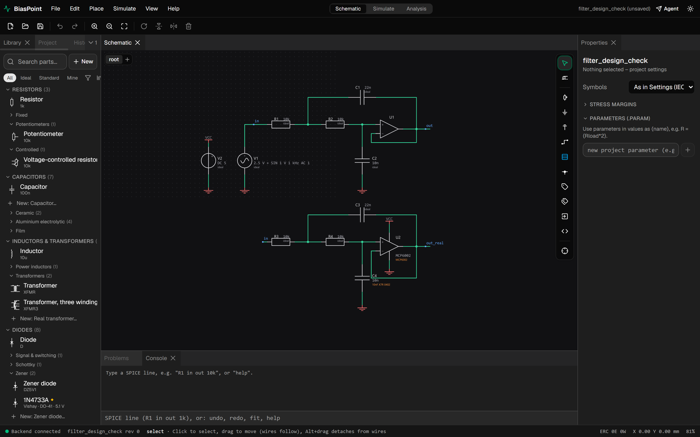
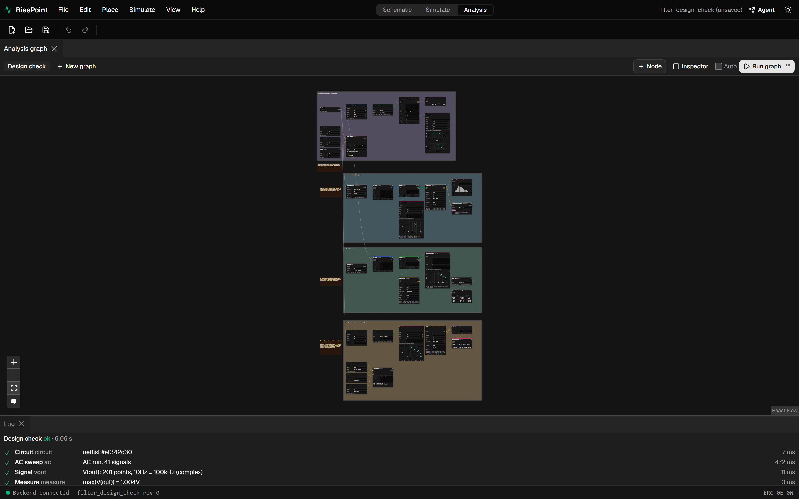
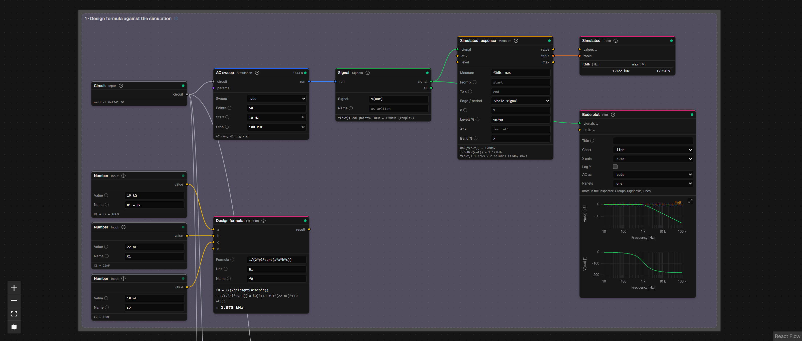
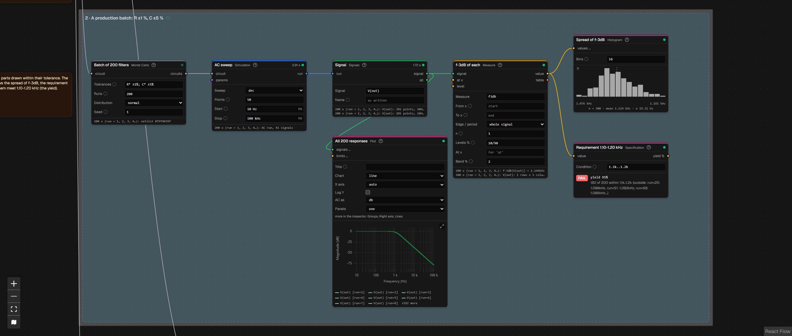
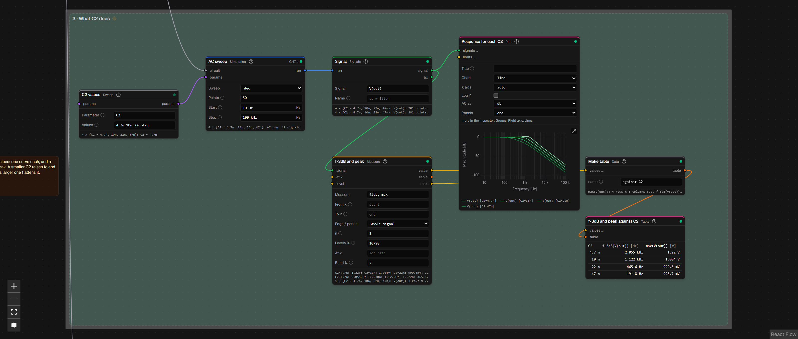
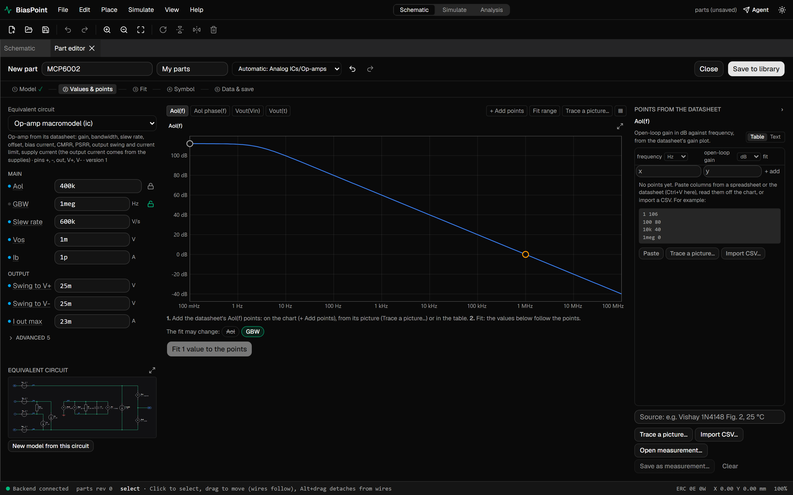
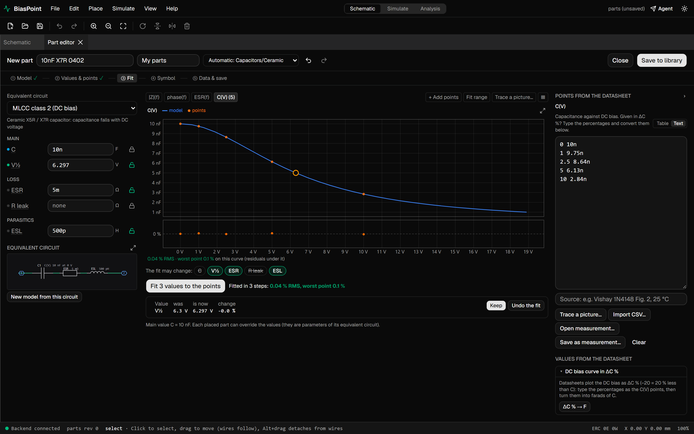
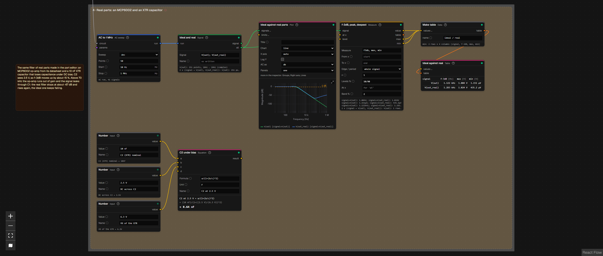
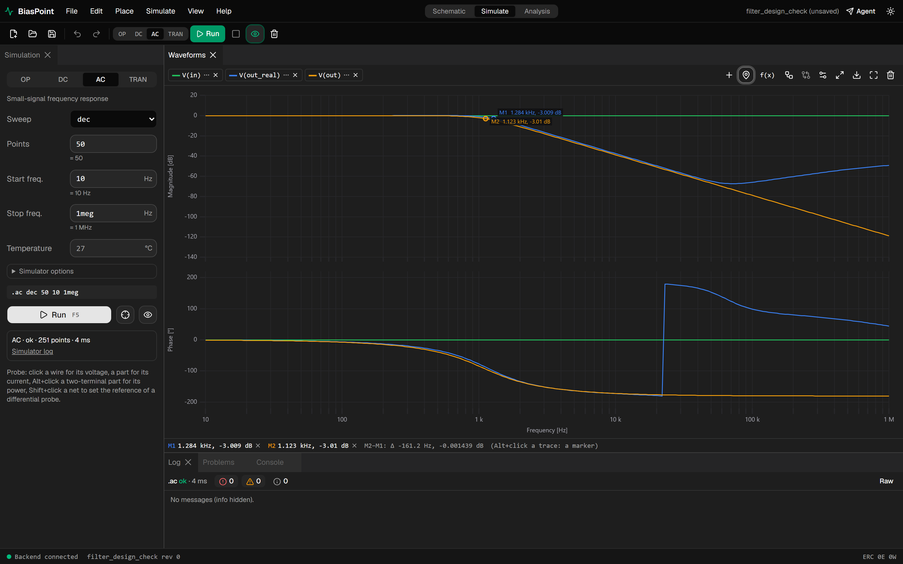

# BiasPoint

**A circuit simulator with analysis graphs: schematic, ngspice, and the engineering around it.**

> [!WARNING]
> **This is a very early version (beta v0.1).** It is not ready for production work. Many things are unfinished, many have rough edges, and some of them are wrong. File formats may change between versions without migration. Expect crashes, missing features, inconsistent UI and odd defaults. Always check important results against a second tool. Bug reports are welcome.

BiasPoint is a desktop-style application that runs locally: a React user interface in the browser, a Python (FastAPI) backend, and [ngspice](https://ngspice.sourceforge.io/) as the simulation engine. Small Rust modules handle the heavy lifting (decimating waveforms with millions of points).

Most simulators stop at "run a simulation, look at a waveform". BiasPoint adds an **analysis graph**: simulations, calculations, measurements, sweeps, Monte Carlo runs, requirements and plots connected as nodes. A graph is saved with the project and recomputed when the circuit changes. Only the parts that changed are recomputed; the rest comes from a cache that survives restarts.

---

## A worked example: checking a filter design

The project `examples/filter_design_check.bpt` (**File → Open example… → Filter design check**) takes a second-order Sallen-Key low-pass filter (R1 = R2 = 10 kΩ, C1 = 22 nF, C2 = 10 nF) and answers four questions a designer asks, in one graph:

1. **Does the circuit do what the formula says?**
2. **What will a production batch look like, with real part tolerances?**
3. **What happens if I change C2?**
4. **What changes when the ideal parts are replaced by real ones?** Here these are an op-amp and a ceramic capacitor, both made from their datasheets in the part editor.

Press **F5** in the **Analysis** workspace. The whole graph runs in a few seconds: two AC sweeps, a batch of 200 Monte Carlo runs and a 4-point parameter sweep.

The schematic holds the filter twice:

- **Top:** with an ideal op-amp and ideal capacitors.
- **Bottom:** built of real parts. U2 is an MCP6002 op-amp powered from 5 V, and C4 is a 10 nF X7R ceramic capacitor. The input is biased at 2.5 V, as in a single-supply circuit.



### The whole graph

Four groups, each with a note that explains what it shows. Every box is a node, and every wire carries data: a circuit, a simulation run, a signal, a number or a table.



### 1 · The design formula against the simulation

- **Number** nodes hold the component values with their units.
- The **Equation** node shows the textbook formula f0 = 1/(2π√(R1·R2·C1·C2)). It is shown with the values put in and the result, like a worked example on paper: **f0 = 1.073 kHz**.
- The **Measure** node takes several measurements of the simulated response at once and gives **f-3dB = 1.122 kHz** and the peak gain.
- The **Bode plot** has reference lines at 0 dB and -3 dB.

The two numbers differ on purpose. The formula gives the natural frequency, but this filter has Q = 0.74 rather than 0.707, so its -3 dB point sits a little higher. One look at the graph shows it; a hand calculation would not.



### 2 · A production batch: R ±1 %, C ±5 %

A **Monte Carlo** node makes 200 copies of the circuit with every resistor and capacitor drawn within its tolerance. Everything after it runs once per copy:

- 200 AC sweeps, run in parallel;
- 200 responses on one plot;
- the f-3dB of each, shown as a **histogram** (mean 1.123 kHz, σ ≈ 18 Hz);
- a **Specification** node that checks the requirement "f-3dB between 1.10 and 1.20 kHz".

The result: **182 of 200 pass (91 % yield)**. The node reports FAIL and lists the runs outside the limits. This is the kind of answer that otherwise takes a script and an afternoon.



### 3 · What C2 does

A **Sweep** node sets C2 to 4.7, 10, 22 and 47 nF. The plot shows one curve per value, and a **table** gives f-3dB and the peak for each C2. A smaller C2 raises the cut-off and the Q (the response peaks); a larger one lowers it and flattens it.



### 4 · Creating real parts

Ideal parts answer "does the topology work?". Real parts answer "will the board work?". BiasPoint makes a real part from its datasheet: you pick an equivalent-circuit template, type the datasheet values or points, and the part editor shows the part's characteristics, simulated, against those points.

**An op-amp from its datasheet values.** The steps:

1. Open **File → New part…** and choose the template **Op-amp macromodel**.
2. Enter the typical values from the MCP6002 datasheet: open-loop gain 400k (112 dB), GBW 1 MHz, slew rate 0.6 V/µs, offset 1 mV, bias current 1 pA, output swing 25 mV from each rail, output current 23 mA. CMRR, PSRR and the supply current are under *Advanced*.
3. Check the open-loop gain Aol(f), computed by simulating the macromodel. GBW is a handle you can drag on the chart, and datasheet points can be pasted or traced from a picture of the datasheet's plot and fitted.
4. Click **Save to library**. The part goes to *My parts*.



**A ceramic capacitor that loses capacitance under DC bias.** Class 2 ceramics (X5R, X7R) lose a large part of their capacitance with DC voltage, and small packages lose the most. The steps:

1. Choose the template **MLCC class 2 (DC bias)**.
2. Enter C = 10 nF.
3. Paste points of the capacitance against DC voltage, read from the manufacturer's DC-bias chart. The example uses illustrative values typical of a small 0402 X7R part.
4. Click **Fit**. It finds V½, the voltage at which the capacitance halves: **6.3 V**, with an error of 0.04 %. The model's curve now goes through the points.



### 5 · Using them: the ideal filter against the real one

The saved parts are placed from the library like any other part. A placed part brings its equivalent circuit into the project, so the project opens and simulates on any computer, even without your library. In the example, U2 and C4 are these two parts.

The fourth group of the graph runs both filters and compares them:

- **The cut-off moves by 14 %.** C2 has 2.5 V across it. An Equation node shows how much capacitance is left: 10 nF / (1 + (2.5 / 6.3)²) = **8.64 nF**. As a result, f-3dB moves from **1.122 kHz to 1.283 kHz**. The ideal model cannot show this, and in a filter with ±5 % parts it is the largest error.
- **The stop band leaks.** As the frequency rises, the MCP6002's loop gain falls (GBW is 1 MHz) and its closed-loop output impedance rises. The signal that leaks through C1 to the output is no longer held down. The real filter reaches only about **−67 dB** at 72 kHz and then rises back to −49 dB at 1 MHz. The ideal one keeps falling to −119 dB. This is a well-known limitation of Sallen-Key filters, and it shows up only with a real op-amp model.



### The quick path: Simulate

For everyday work there is the classic LTspice-like workflow: choose an analysis (OP / DC / AC / TRAN), press F5 and probe nets on the schematic. The waveform viewer has panes, Bode plots and XY plots, can compare a run with the previous one, and offers cursors, crosshairs and markers.

The screenshot shows the same comparison: V(out) of the ideal filter in orange and V(out_real) of the real one in blue. The **-3 dB markers**, placed from the markers menu, land on **1.123 kHz** and **1.284 kHz**, and the bar under the plot shows their difference. The leak-through above 70 kHz is easy to see.



### Why a graph?

| | Typical simulator | BiasPoint |
|---|---|---|
| Formula vs. simulation | calculator on the side | an Equation node next to the measured value, recomputed with the circuit |
| Tolerances | `.step` + scripts, or a separate tool | Monte Carlo node → histogram → requirement with yield |
| Many measurements | `.meas` lines, results in a log | Measure nodes with outputs, tables and plots |
| Sweeps | curves you read by eye | a family of curves + a table of measured values |
| Real parts | vendor models, if there are any | parts made from the datasheet in minutes (values or fitted curves), embedded in the project |
| Re-running | everything again | only what changed; the cache survives restarts |
| Sharing the reasoning | screenshots and notes | the graph is saved in the project, with groups and notes |

---

## What works today

A very general list; each item has known gaps.

- **Schematic editor:**
  - parts, wires, labels, power symbols;
  - hierarchical sheets and blocks;
  - IEC and ANSI symbols, undo history, snapshots;
  - autosave with crash recovery.
- **Components:**
  - ideal parts and a library of real parts (resistors, capacitors, inductors, diodes, BJTs, MOSFETs, op-amps, regulators and more);
  - behavioural ICs (e.g. LM2596) and modules built of real parts;
  - a part editor that fits SPICE models to datasheet curves;
  - pasting `.model` / `.subckt` text and importing SPICE netlists.
- **Simulation:** OP, DC sweep, AC and transient with ngspice, in separate worker processes. Probes for voltages, currents and power. Large runs (millions of points) stay responsive thanks to decimation.
- **Waveform viewer:** panes, Bode, XY, comparison with the previous run, cursors A/B, crosshairs with values, markers (manual and automatic), export to PNG, SVG and CSV.
- **Analysis graph:**
  - simulations, signals and expressions;
  - Measure (several measurements, windows, edges and periods), FFT, filters and time windows;
  - parameter, temperature and tolerance sweeps, Monte Carlo;
  - Specification (pass/fail with yield), histograms, tables, equations, plots with panels and limits;
  - Number, Calculus, Lookup and Complex-parts nodes;
  - groups, notes, bypass, node inspector, parameters driven from other nodes, a disk cache.
- **Stress check:** part ratings against the simulated voltages, currents and power.
- **AI agent integration:** an MCP server lets an AI assistant build circuits, run analyses and read results through the same API as the UI.

## What is planned

- **Waveform viewer:** annotations, measurements drawn on the plot, zoom history, an overview bar, export styling, reference traces.
- **Electrical and math nodes:** impedance, network parameters, matching, noise quantities, curve fitting, a Smith chart.
- **New analyses:** noise, pole-zero, sensitivity, S-parameters, loop stability, worst case.
- **RF:** a frequency-domain solver for RF circuits.
- **Digital simulation:** XSPICE digital models and Verilog / VHDL co-simulation.
- **Engineering tools:** optimizer, design tables, requirements and reports (PDF, HTML, DOCX).
- **Graph reuse:** subgraphs, user-defined nodes, a template library.
- **Measured data:** import, Touchstone files.
- **Documentation and polish:** user documentation, tutorials and installers, and testing on Linux and macOS (development so far is on Windows).

---

## Getting started (developers)

There is no installer yet; you run it from source.

### Requirements

- **Python 3.13** and [uv](https://docs.astral.sh/uv/)
- **Node.js 22+** and [pnpm](https://pnpm.io/)
- **Rust** (stable, 1.85+): the native helper module is built automatically by `uv sync`
- **ngspice** as a shared library (`ngspice.dll` / `libngspice.so`), tested with ngspice 47. If it is not in a standard location, point to it:

  ```bash
  # Windows (PowerShell)
  $env:BPT_NGSPICE_LIB = "C:\path\to\ngspice.dll"
  # Linux
  export BPT_NGSPICE_LIB=/usr/lib/x86_64-linux-gnu/libngspice.so.0
  ```

### Run

```bash
cd backend && uv sync && uv run bpt info     # versions and an ngspice self-test
cd ../apps/web && pnpm install
cd ../.. && ./scripts/dev.sh                  # Windows: ./scripts/dev.ps1
```

Then open <http://127.0.0.1:5173>. Examples are under **File → Open example…**.

### Tests

```bash
bash scripts/check.sh                 # everything (backend, Rust, frontend, E2E)
bash scripts/check.sh --quick         # the fast subset
git config core.hooksPath .githooks   # run the quick checks before each commit
```

### Repository layout

| Path | What |
|---|---|
| `apps/web/` | React + TypeScript user interface (Vite, React Flow, uPlot) |
| `backend/` | Python backend: document model, netlister, ngspice engine, analysis graph, API, MCP server |
| `engine/` | Rust helper modules (waveform decimation, exported to Python) |
| `examples/` | example projects (generated by `uv run bpt examples`) |
| `schemas/` | JSON schemas of the project file format |
| `tests/golden/` | reference circuits checked against ngspice |
| `scripts/` | development scripts |

---

## Author

**RBorczuch**

## License

No license has been chosen yet: all rights reserved. Please ask before using the code outside personal evaluation.
