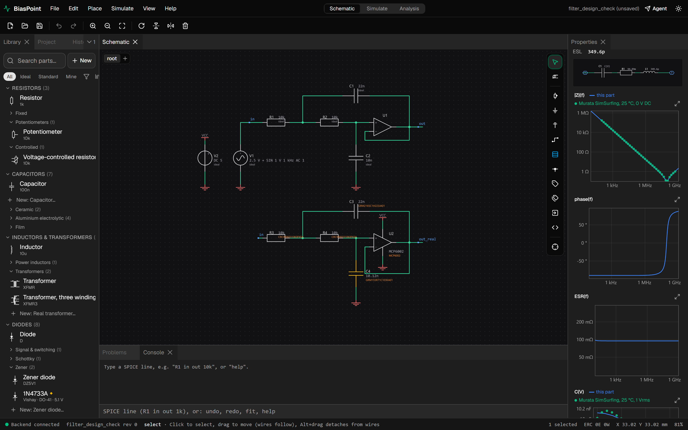
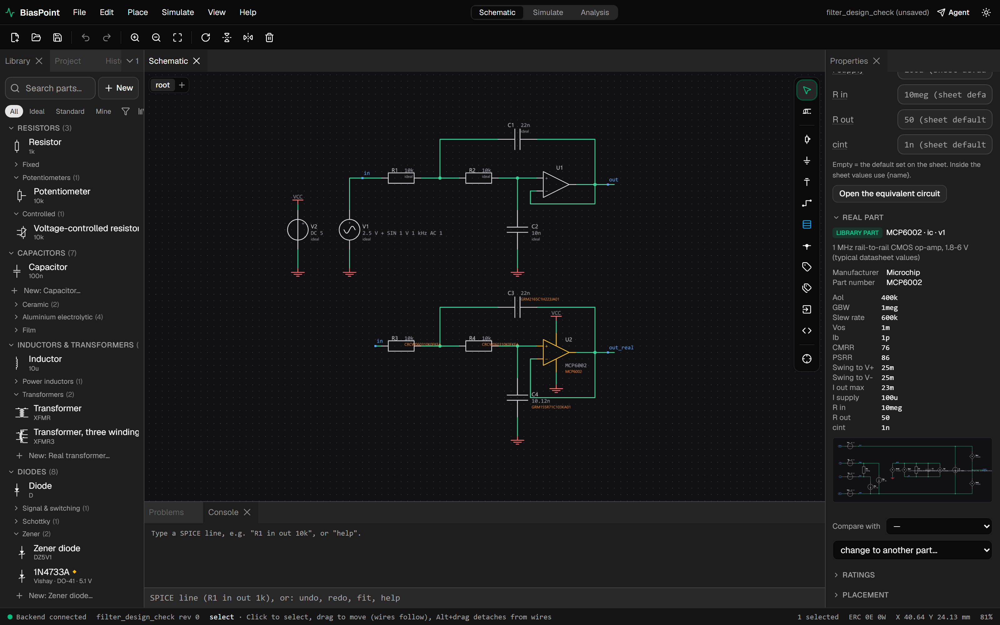
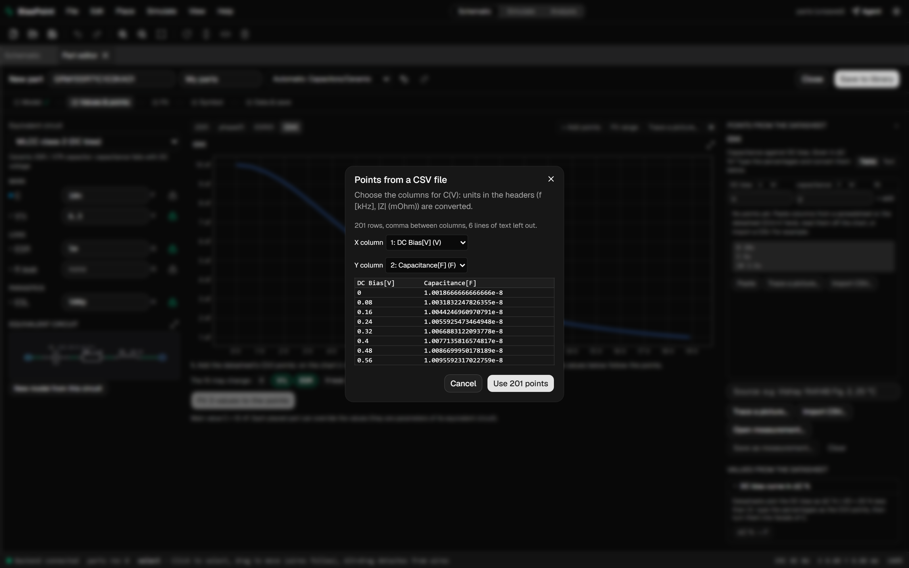
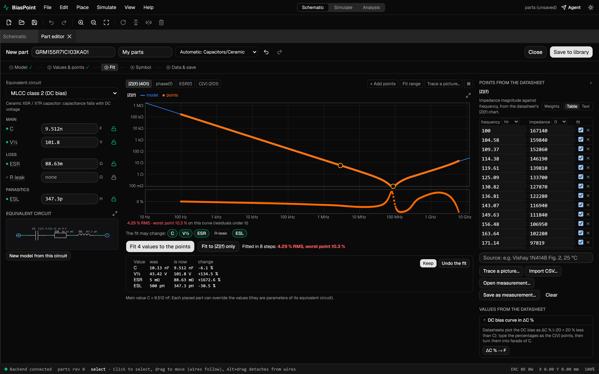
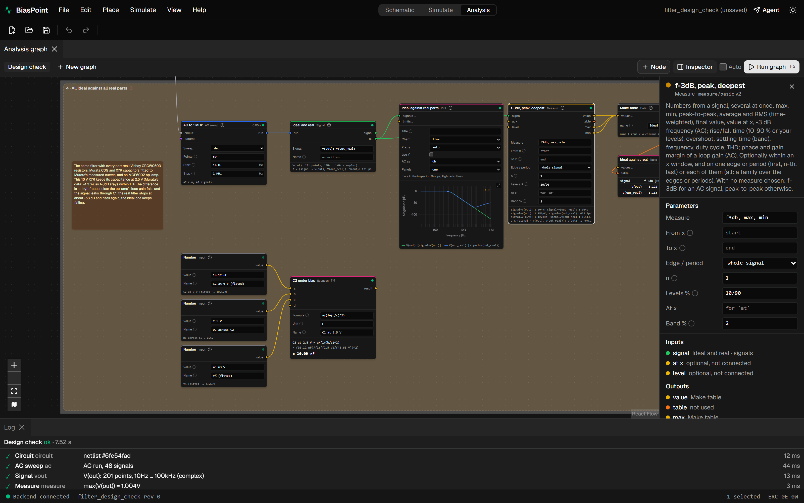

# BiasPoint

A circuit simulator with an analysis graph: schematic capture, ngspice simulation, and the engineering workflow around them.

> [!WARNING]
> Beta v0.1. Not suitable for production work. Features are incomplete and some are incorrect. File formats may change without migration. Expect crashes, missing features, inconsistent UI, and unvalidated defaults. Verify results against a second tool. Bug reports are welcome.

BiasPoint is a locally running, desktop-style application: a React interface in the browser, a Python (FastAPI) backend, and [ngspice](https://ngspice.sourceforge.io/) as the simulation engine. Native Rust modules handle heavy computation (waveform decimation for multi-million-point runs).

Most simulators stop at "run a simulation and inspect a waveform". BiasPoint adds an **analysis graph**: simulations, calculations, measurements, sweeps, Monte Carlo runs, requirements, and plots represented as connected nodes. The graph is stored with the project and recomputed when the circuit changes. Only affected nodes are recomputed; the remainder is served from a cache that persists across restarts.

## Motivation

**Automation of simulations and post-processing.** After a simulation, the results typically require further processing: computing power or efficiency, comparing runs, checking a requirement. The usual workflow involves three manual steps:

1. Export the data.
2. Import it into a spreadsheet.
3. Enter the formulas by hand.

Changing a single component value repeats the entire process. This is time-consuming, and each export or hand-written formula is another opportunity for error.

In BiasPoint, these calculations live in the analysis graph alongside the circuit and are re-executed automatically when the circuit changes.

**Readable, reproducible component models.** Manufacturer models are often opaque: a list of cryptic parameters that conveys little about how the part behaves. Building a model from a datasheet, characteristic curves, or measurements is similarly tedious.

The part editor builds a real part from an equivalent-circuit template and fits it to the available data:

- datasheet values;
- curves exported from vendor tools (e.g. Murata capacitors);
- user measurements.

It then plots the model characteristics against the measured points to quantify the fit.

---

## Worked example: filter design check

The project `examples/filter_design_check.bpt` (**File → Open example… → Filter design check**) examines a second-order Sallen-Key low-pass filter (R1 = R2 = 10 kΩ, C1 = 22 nF, C2 = 10 nF) and answers four questions in a single graph:

1. **Does the circuit behave as the design equation predicts?**
2. **How does the filter perform across a production batch, given per-part tolerances?**
3. **What is the effect of changing C2?**
4. **How does the response change when ideal parts are replaced by real ones?** Real parts are built in the part editor from manufacturer data: Murata capacitors fitted to Murata's measured curves, Vishay resistors, and a Microchip op-amp.

Press **F5** in the **Analysis** workspace. The graph completes in a few seconds: two AC sweeps, 200 Monte Carlo runs, and a 4-point parameter sweep.

The schematic contains the filter twice:

- **Top:** all ideal.
- **Bottom:** all real. R3 and R4 are Vishay CRCW060310K0FKEA resistors, C3 a Murata GRM2165C1H223JA01 capacitor (22 nF C0G 0805), C4 a Murata GRM155R71C103KA01 (10 nF X7R 0402), and U2 a Microchip MCP6002 op-amp powered from 5 V. The input is biased at 2.5 V, as in a single-supply circuit.

Selecting a part opens its properties in the side panel. For C4 this includes manufacturer, part number, package, rated voltage, the fitted values, and the equivalent circuit (C with DC-bias law, ESR, ESL). The panel also plots the simulated characteristics against Murata's measured points: |Z|(f), phase, ESR(f), and C(V).




The op-amp shows its datasheet values, each of which can be overridden for the placed instance:



### The graph

Four groups, each with an explanatory note. Every box is a node; every wire carries data: a circuit, a simulation run, a signal, a number, or a table.


### 1 · Design equation vs. simulation

- **Number** nodes hold the component values with units.
- The **Equation** node shows the textbook formula f0 = 1/(2π√(R1·R2·C1·C2)), with the substituted values and the result: **f0 = 1.073 kHz**.
- The **Measure** node extracts several values from the simulated response, including **f-3dB = 1.122 kHz** and the peak gain.
- The **Bode plot** has reference lines at 0 dB and −3 dB.

The two numbers differ by design. The equation yields the natural frequency, but the filter has Q = 0.74 rather than 0.707, so the −3 dB point sits slightly higher. 


### 2 · Production batch of the real filter

A **Monte Carlo** node generates 200 copies of the real filter. Each part is drawn within its datasheet tolerance: Vishay resistors ±1 %, Murata C0G C3 ±5 % (code J), Murata X7R C4 ±10 % (code K). The X7R retains its DC-bias model in every copy. All downstream nodes run once per copy:

- 200 AC sweeps, executed in parallel;
- 200 responses on one plot;
- f-3dB of each copy, shown as a **histogram** (mean 1.115 kHz, σ ≈ 35 Hz);
- a **Specification** node checking the requirement "f-3dB between 1.10 and 1.20 kHz".

Result: **129 of 200 pass (64.5 % yield)**. The node reports FAIL and lists the runs outside the limits. The X7R's ±10 % dominates the spread. With the capacitors held at ±5 %, the same batch would yield 91 %. The actionable conclusion is to use a ±5 % C0G for C4 or relax the requirement.


### 3 · Effect of C2

A **Sweep** node sets C2 to 4.7, 10, 22, and 47 nF. The plot shows one curve per value, and a **table** lists f-3dB and the peak for each. A smaller C2 raises the cut-off and the Q (the response peaks); a larger one lowers and flattens it.


### 4 · Building real parts from manufacturer data

Ideal parts answer "does the topology work?"; real parts answer "will the board work?". A real part is built from its data: select an equivalent-circuit template, enter datasheet values or import vendor curves, and the part editor fits the model and reports the fit.

**Capacitors from Murata's measured curves.** Murata publishes measured characteristics via [SimSurfing](https://ds.murata.co.jp/simsurfing/mlcc.html?lcid=en-us). Procedure:

1. In SimSurfing, export the *DC Bias* and *Frequency (|Z|)* characteristics of GRM155R71C103KA01 as CSV.
2. In BiasPoint, open **File → New part…** and select the **MLCC class 2 (DC bias)** template.
3. Click **Import CSV…** on the C(V) chart and select the columns. Units in headers ("DC Bias[V]", "Capacitance[F]") are parsed automatically.
4. Click **Fit**. The model C(V) = C / (1 + (V/V½)²) yields **C = 10.13 nF, V½ = 43.4 V**, 0.28 % RMS error.
5. Import the |Z|(f) curve and fit again for ESR and ESL: **ESR ≈ 91 mΩ, ESL ≈ 342 pH**, 7 % RMS error. Murata measures the two curves at different AC levels, and an X7R's capacitance depends on the AC level, so a single C cannot match both exactly.
6. Click **Save to library**. The measured points are stored with the part.






The C0G capacitor GRM2165C1H223JA01 is built the same way from its |Z|(f). Its capacitance is independent of DC bias. The fit gives ESR 20.7 mΩ and ESL 464 pH, 14 % RMS error, mostly from the template's constant ESR while the real ESR varies with frequency.

**Resistors:** CRCW060310K0FKEA (10 kΩ ±1 % 0603, 0.1 W, 75 V). Vishay does not publish parasitics, so series inductance and shunt capacitance use values typical of the 0603 package.

**An op-amp from datasheet values.** Procedure:

1. Select the **Op-amp macromodel** template.
2. Enter the typical MCP6002 datasheet values: open-loop gain 400k (112 dB), GBW 1 MHz, slew rate 0.6 V/µs, offset 1 mV, bias current 1 pA, output swing 25 mV from each rail, output current 23 mA. CMRR, PSRR, and supply current are under *Advanced*.
3. Verify the open-loop gain Aol(f), computed by simulating the macromodel. GBW is adjustable by dragging on the chart.


### 5 · Ideal vs. real parts in use

Saved parts are placed from the library like any other part. A placed part embeds its equivalent circuit in the project, so the project opens and simulates on any machine, independent of the local library.

The fourth group runs both filters and compares them:

- **The cut-off is stable: 1.113 kHz vs. 1.122 kHz (−0.8 %).** A common rule of thumb holds that X7R capacitors lose a large fraction of their capacitance under DC bias. A typical "V½ = 6.3 V" model would predict a 14 % loss at 2.5 V and a corresponding upward shift in cut-off. Murata's measured data contradicts this: a 16 V, 10 nF X7R gains 1.3 % at 2.5 V and loses only 11 % at 16 V. An Equation node shows the fitted value at 2.5 V: **10.09 nF**. The DC-bias effect is real for parts with high capacitance relative to size and voltage, but not for this part; only the manufacturer's data distinguishes the cases.
- **The stop band leaks.** As frequency rises, the MCP6002's loop gain falls (GBW 1 MHz) and its closed-loop output impedance rises, so the signal leaking through C1 is no longer suppressed. The real filter reaches approximately **−68 dB** at 72 kHz and then rises to −49 dB at 1 MHz; the ideal filter falls to −119 dB. This is a known limitation of Sallen-Key filters and appears only with a real op-amp model.


Each node has an inspector showing all parameters, inputs, outputs, and the full log of its last run:



### Simulate workspace

For everyday work, BiasPoint also provides a classic LTspice-style workflow: choose an analysis (OP / DC / AC / TRAN), press F5, and probe nets on the schematic. The waveform viewer supports panes, Bode and XY plots, comparison with the previous run, cursors, crosshairs, and markers.

The screenshot shows the same comparison: V(out) of the ideal filter (orange) and V(out_real) of the real filter (blue). The **−3 dB markers** land on **1.123 kHz** and **1.113 kHz**; the bar below the plot shows the difference. The leakage above 70 kHz is clearly visible.

The phase shows the same behaviour:

- **Ideal filter:** the phase approaches −180°, as expected for a second-order low-pass, and matches the analytic transfer function to within 2·10⁻⁶.
- **Real filter:** the phase continues past −180° to about −315° at 1 MHz. Above the 72 kHz dip, gain rises while phase keeps lagging — non-minimum-phase behaviour: the signal leaking through C1 reaches the output with opposite sign.

The viewer draws phase unwrapped, so crossing −180° does not appear as a false jump to +180°.


### Why a graph?


| Concern                | Typical simulator                     | BiasPoint                                                                                                      |
| ---------------------- | ------------------------------------- | -------------------------------------------------------------------------------------------------------------- |
| Formula vs. simulation | separate calculator                   | Equation node next to the measured value, recomputed with the circuit                                          |
| Tolerances             | `.step` + scripts, or a separate tool | Monte Carlo node over real parts with their own tolerances → histogram → requirement with yield              |
| Many measurements      | `.meas` lines, results in a log       | Measure nodes with outputs, tables, and plots                                                                  |
| Sweeps                 | curves read by eye                    | a family of curves plus a table of measured values                                                             |
| Real parts             | vendor models, where available        | parts built from manufacturer data in minutes (values, or imported and fitted curves), embedded in the project |
| Re-running             | everything                            | only what changed; cache persists across restarts                                                              |
| Sharing the reasoning  | screenshots and notes                 | the graph is saved with the project, with groups and notes                                                     |

---

## Implemented

Each item has known gaps.

- **Schematic editor:** parts, wires, labels, power symbols; hierarchical sheets and blocks; IEC and ANSI symbols; undo history; snapshots; autosave with crash recovery.
- **Components:** ideal parts and a library of real parts (resistors, capacitors, inductors, diodes, BJTs, MOSFETs, op-amps, regulators, and others); behavioural ICs (e.g. LM2596) and modules built from real parts; a part editor that fits SPICE models to datasheet curves; pasting `.model` / `.subckt` text and importing SPICE netlists.
- **Simulation:** OP, DC sweep, AC, and transient with ngspice in separate worker processes; probes for voltages, currents, and power; decimation keeps multi-million-point runs responsive.
- **Waveform viewer:** panes, Bode, XY, comparison with the previous run, cursors A/B, crosshairs with values, markers (manual and automatic), export to PNG, SVG, and CSV.
- **Analysis graph:** simulations, signals, expressions; Measure (multiple measurements, windows, edges, periods); FFT, filters, time windows; parameter, temperature, and tolerance sweeps; Monte Carlo; Specification (pass/fail with yield); histograms, tables, equations, plots with panels and limits; Number, Calculus, Lookup, and Complex-parts nodes; groups, notes, bypass, node inspector, parameters driven from other nodes, disk cache.
- **Stress check:** part ratings against simulated voltages, currents, and power.
- **AI agent integration:** an MCP server exposing the same API as the UI, allowing an AI assistant to build circuits, run analyses, and read results.

## Roadmap

- **Waveform viewer:** annotations, on-plot measurements, zoom history, overview bar, export styling, reference traces.
- **Electrical and math nodes:** impedance, network parameters, matching, noise quantities, curve fitting, Smith chart.
- **New analyses:** noise, pole-zero, sensitivity, S-parameters, loop stability, worst case.
- **RF:** a frequency-domain solver.
- **Digital simulation:** XSPICE digital models and Verilog / VHDL co-simulation.
- **Engineering tools:** optimizer, design tables, requirements, reports (PDF, HTML, DOCX).
- **Graph reuse:** subgraphs, user-defined nodes, template library.
- **Measured data:** import, Touchstone files.
- **Documentation:** user documentation, tutorials, installers; testing on Linux and macOS (development so far is on Windows).

---

## Getting started (developers)

No installer yet; the application runs from source.

### Requirements

- **Python 3.13** and [uv](https://docs.astral.sh/uv/)
- **Node.js 22+** and [pnpm](https://pnpm.io/)
- **Rust** (stable, 1.85+): the native helper module is built automatically by `uv sync`
- **ngspice** as a shared library (`ngspice.dll` / `libngspice.so`), tested with ngspice 47. If it is not in a standard location, set the path explicitly:

  ```bash
  # Windows (PowerShell)
  $env:BPT_NGSPICE_LIB = "C:\path\to\ngspice.dll"
  # Linux
  export BPT_NGSPICE_LIB=/usr/lib/x86_64-linux-gnu/libngspice.so.0
  ```

### Run

```bash
cd backend && uv sync && uv run bpt info     # versions and an ngspice self-test
cd ../apps/web && pnpm install
cd ../.. && ./scripts/dev.sh                  # Windows: ./scripts/dev.ps1
```

Then open [http://127.0.0.1:5173](http://127.0.0.1:5173). Examples are under **File → Open example…**.

### Tests

```bash
bash scripts/check.sh                 # everything (backend, Rust, frontend, E2E)
bash scripts/check.sh --quick         # the fast subset
git config core.hooksPath .githooks   # run the quick checks before each commit
```

### Repository layout


| Path            | Purpose                                                                                    |
| --------------- | ------------------------------------------------------------------------------------------ |
| `apps/web/`     | React + TypeScript UI (Vite, React Flow, uPlot)                                            |
| `backend/`      | Python backend: document model, netlister, ngspice engine, analysis graph, API, MCP server |
| `engine/`       | Rust helper modules (waveform decimation, exported to Python)                              |
| `examples/`     | example projects (generated by`uv run bpt examples`)                                       |
| `schemas/`      | JSON schemas of the project file format                                                    |
| `tests/golden/` | reference circuits checked against ngspice                                                 |
| `scripts/`      | development scripts                                                                        |

---

## Author

**Radosław Borczuch**

## License

No license has been chosen yet; all rights reserved. Contact the author before using the code outside personal evaluation.
